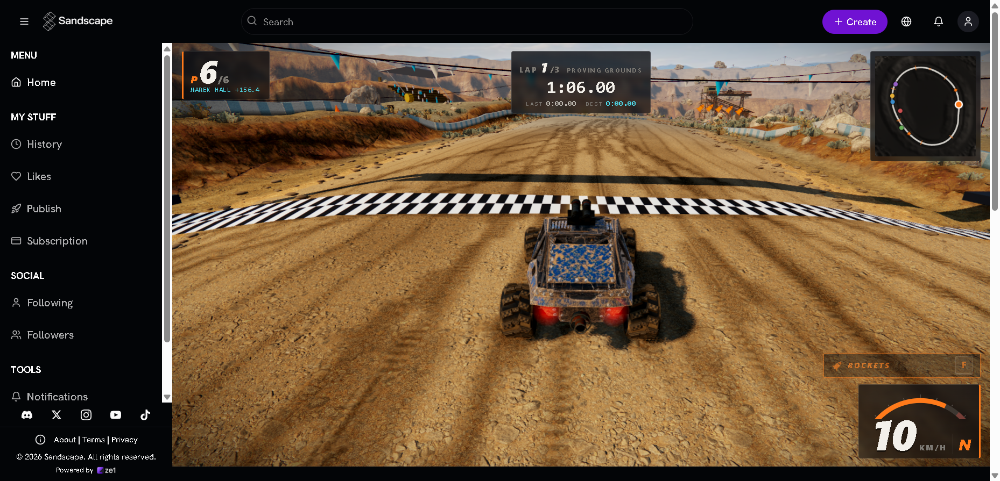

# SANDSCAPE — offline mirror

Full mirror of the **Sandscape** app shell for the pinned play view
(https://sandscape.app/play?g=3UpDloEh) — the SPA that plays the published game
**RALLY ROAD RASH — Off-Road Championship**.

Source: https://sandscape.app/play?g=3UpDloEh



> **Cover note (2026-10-13).** The image above is the game **mid-race**
> (LAP 1/3 · PROVING GROUNDS, timer 1:06.00, 10 KM/H on the track). The play
> view is a route on the Sandscape SPA: the SPA resolves `?g=3UpDloEh` through
> its live backend to game id `3e1a1e7f-…` and *embeds* it from the external
> game service. That embed carries `frame-ancestors 'self'
> https://sandscape.app …` — the game host allows framing only from Sandscape
> origins, so a loopback mirror cannot render it (Chrome blocks the frame; the
> boot evidence `docs/boot-2026-10-13.png` shows exactly that: the captured
> SPA rendering the play route with the embed area empty). The cover was
> therefore captured from the play view **as served by the origin**, driving
> the same captured SPA build; the mirror itself reproduces everything except
> the external game content. The full game is also playable from the live
> origin — this mirror does not fake it.

## Stack

- **Vite/rolldown production build** — one ~50-chunk runtime graph under
  `assets/`: the entry chunk (`index-CBcimEr9.js`), the rolldown runtime, the
  React 19 runtime (`react-dom`, `jsx-runtime`), the Vite preload helper and
  per-route/per-widget chunks loaded at runtime (`Game-…`, `Auth-…`,
  `Profile-…`, `Create-…`, `History-…`, `ShareMenu-…`, the `dist-…` UI kit
  chunks, `i18n-…`, `CoinDisplay-…`, …).
- **React 19 + Radix UI + framer-motion + Tailwind** in the chunk graph — the
  `proxy-…` chunk is the bundled framer-motion, `AuthService-…` merges
  `@supabase/supabase-js` with the app's auth facade, `three.module-…` /
  `three-stdlib-…` / `SceneEditor-…` carry the bundled three.js used by the
  scene editor and previews.
- **A live backend by design** — game records, comments, likes, leaderboards
  and the published game content itself are fetched at runtime from Supabase
  and the Sandscape game service (external; see below).

## What this is

Sandscape is an AI game-creation platform: users prompt a game, refine it in a
visual editor, publish it, and play it at `/play?g=<short_code>`. This mirror
pins the **play view for the short code `3UpDloEh`** — the game page of
*RALLY ROAD RASH — Off-Road Championship* (an arcade off-road racer: four
machines, five stages, rockets, drift boosts) — and captures the app shell that
renders it, byte-exact: the entry document plus the whole same-origin chunk
graph the runtime actually loads (runtime network log + static scan to
fixpoint). **129 files, ≈11.0 MB** (`.upstream/manifest.json`, refresh
2026-10-29).

External at runtime (never captured, never backfilled — documented gaps):

- **Supabase** (`rdfaagiybxrefnekhwrk.supabase.co`) — auth/session, profiles,
  the `games` table the `?g=` query resolves against, comments, likes, avatars.
- **Sandscape game service** (`sandscape-prod.fly.dev`) — the published-game
  backend: the game document
  (`/api/published/3e1a1e7f-…/index.html`), view counting, play tokens and
  leaderboards; its response pins `frame-ancestors` to Sandscape origins.
- **Game asset CDN** (`games.sandscape.app`) — the game's own styles, code
  (`src/main.js`, three.js, world builders) and art, addressed by the game
  document's `<base href>`; plus game thumbnails on
  `gamemedia.sandscape.app`.
- **Google Fonts** (`fonts.googleapis.com` CSS → `fonts.gstatic.com` woff2) —
  the entry links the Hanken Grotesk stylesheet; it stays a CDN dependency.
- **Vercel analytics** — same-origin `/_vercel/insights/*` beacon (excluded
  from the capture as a telemetry endpoint).

The embedded game's closure (document and assets) is recorded in
`_mirror-report.json` (`gameClosure`, `externalDependencies`), not captured:
the fleet rule is that external dependencies stay external.

## Layout

- `index.html` — the entry document as served for `/play` (Vercel rewrites the
  route onto the built `spa.html`; 8,814 B, byte-exact)
- `assets/` — the full same-origin chunk graph (117 JS chunks + 2 stylesheets)
  and the icons/OG images the app loads
- `.upstream/manifest.json` — sha256 for every captured file
- `.upstream/runtime-network.json` — every request the live browser session
  recorded while the pinned view loaded and the game page rendered (86 entries;
  the closure evidence)
- `.upstream/unreachable.json` — probed paths the origin does not serve (the
  SPA rewrite answers them with the SPA document; recorded, never captured)
- `readable/assets/` — prettified derived layer (pinned prettier 3.9.6), the
  served path mirrored: 118 JS pretties + 2 CSS pretties, plus 2 inline twins
  from `index.html` at the `readable/` root; vendor bundles are whole-file
  entries
- `src/assets/` + `split-spec.json` — 658 statement-aligned slices of the 109
  app chunks, served filenames (hash included) kept with the `-NN` slice
  suffix, with the recorded derivation spec
- `rename-map.json` + `tools/names.json` — the identifier-rename campaign: the
  reviewed semantic list and the mechanically recovered map that `src/` is
  re-cut through on every derivation. The 2026-10-29 refresh replaced the whole
  chunk graph (94 new hashed names), so the map was regenerated empty
  (0 renames) — the campaign awaits re-review against the new capture; its
  pre-refresh state is archived under `legacy/2026-10-29/`
- `tools/capture.mjs` — the capture crawler (entry + runtime log seeds →
  closure to fixpoint; SPA-rewrite fallbacks detected and rejected)
- `tools/derive.mjs` — rebuild `readable/` + `src/` + `split-spec.json`
  (re-applies the recorded rename map; `--check` diffs a fresh render)
- `tools/apply-names.mjs` + `tools/recover-scoped-map.mjs` — the rename-campaign
  writer and the mechanical map recoverer; `tools/verify-rename.mjs` +
  `tools/check-chunk.mjs` are the campaign gates
- `tools/update.mjs` — read-only drift probe against the live origin
- `tools/verify.mjs` — re-hash the capture against the manifest
- `tools/record-manifest.mjs` — re-cut / `--check` the capture manifest
- `tools/audit.js` — integrity gate for the derived layers (`AUDIT PASS`)
- `tools/vendor/prettier/` — the pinned prettier **3.9.6** module API vendored
  in-repo (the published tarball's bytes, integrity
  `sha512-OpN0zzVdiaiAhxpuuj5efpIS4sY9j7bY6uR5mnj5yPzGkdkjNKSJeUThPb60Jw29QuAZgA4o+/iB49kFiaBX6g==`;
  the stub `package.json` only carries the version the loaders check). `derive.mjs`
  and `audit.js` resolve `$PRETTIER_MJS` → this copy → `node_modules/prettier`,
  so a clean checkout re-derives without another mirror's tree; derive fails
  naming every path tried when the renderer is missing, and `audit.js` puts the
  skip plus the same tried/fix lines in its verdict instead of passing silently.
- `tools/check-links.mjs` — link gate: every scope of the derived layer
  exports only names the layer declares (the engine is the judge)
- `tools/serve.mjs` — the loopback static server used for the serve probe /
  boot test (SPA rewrite, asset paths 404 honestly)
- `_mirror-report.json` — capture record (method, 404s, origin variants,
  external hosts, the game closure's URL family)
- `docs/cover.png`, `docs/boot-2026-10-13.png`, `docs/boot-2026-10-27.png`,
  `docs/boot-2026-10-29-refresh.png` — gameplay cover and mirror boot evidence

## Assets

Category-first inventory of what this repo carries. **The mirror carries the
app's chrome images, icons and code — not the game's own art/models/audio:**
those are served live from the external game CDN (`games.sandscape.app`,
documented gap; the game is user-generated content and its assets are not part
of the app capture).

- **images — app chrome/branding** — `Sandscape_Logo_White_Large.png`,
  `ze1_logo_horizontal.png`
- **images — favicons/PWA icons** — `favicon.png` (100.7 KB),
  `apple-touch-icon.png`, `android-chrome-192x192.png`,
  `android-chrome-512x512.png`, `maskable-icon-512x512.png`
- **images — social/OG** — `22980108-sandscape-ai-generative-game-en-1200x628.jpeg`
  (the og:image/twitter:image card, 114.8 KB)
- **data** — `manifest.webmanifest` (PWA manifest)
- **code (vendor, whole-file in `readable/`)** — `assets/three.module-CvxFRqeD.js`
  (three.js), `assets/three-stdlib-BJSGSXlY.js` (three-stdlib addons),
  `assets/react-dom-CWn-H0Rd.js`, `assets/jsx-runtime-BtyjnKZj.js`,
  `assets/AuthService-CQeU_0bQ.js` (@supabase/supabase-js + auth facade),
  `assets/proxy-gbdormya.js` (framer-motion),
  `assets/src-C4EM-vcD.js` (WebCodecs media codec library),
  `assets/SceneEditor-BPEsa1Sn.js` (~5.4 MB editor bundle: editor runtime +
  three.js + fflate)
- **code (app, sliced into `src/`)** — the remaining 102 chunks, e.g.
  `assets/index-BKDksszn.js` (entry/routes), `assets/Game-QkGXRHTR.js` (the
  play page: iframe embed, share/likes/leaderboard wiring),
  `assets/gameCreation-*.js`, `assets/i18n-Ddyvvowz.js` (translation data)
- **game content** — none on disk; recorded as external
  (`_mirror-report.json` → `gameClosure`: the RALLY ROAD RASH document,
  `src/main.js`, its 30 module imports and the art referenced by its
  `<base href>`)

## Run

Serve the repo root with a static server that falls back to `index.html` for
unknown routes (the SPA handles `/play` client-side), then open the pinned
route:

```
npx serve -s .          # -s = single-page rewrite to index.html
# then open http://localhost:3000/play?g=3UpDloEh
```

`/` and `/play?g=3UpDloEh` both serve the same captured shell; the app then
hydrates and requests the game record from its live backend. The captured UI
(home, play page, comments/leaderboard shells, share menus, route chunks)
renders from the mirror; the **game embed cannot render from a loopback
origin** — the game service allows framing only from Sandscape origins (see
the cover note above). Everything else the app asks for (Supabase, the game
service, fonts) is live and external.

## Verify

```
node tools/verify.mjs     # re-hash the capture against the manifest
node tools/audit.js       # derived-layer integrity gate (AUDIT PASS)
node tools/check-exports.mjs   # the derived layer still exports every public name
node tools/check-links.mjs     # every scope exports only names the layer declares
```

`check-links.mjs` guards the one class the export-name gate cannot see: a
scope that exports a binding nothing declares is a hard SyntaxError at link
time ("Export 'x' is not defined"), and the scope cannot be imported at all.
The layer is cut from whole modules, so a chunk's recorded export table
legitimately names bindings its SIBLING slices declare — `check-links.mjs`
reassembles each scope from the layer's own bytes plus the mirror's own record
of the skipped export-table tail, reads that tail in the layer's spelling
through `sources[].renameBindings` (the recorded tail is the capture's
spelling, the slices are the layer's), and reports such a binding as a
fragment rather than as a defect. A name that exists in no slice of the scope
is a real break, and the gate names it.

State as of 2026-10-14: `verify.mjs` → `124 files checked, 0 problems`;
`audit.js` → `AUDIT PASS — 640 spec sections (524/524 src↔pretty round-trips
byte-exact, 10 through the recorded rename map, 116/116 pretty sources tiled
contiguously, 102/102 skipped export-table sections re-verified textually,
524/524 src slices + 113/113 readable/*.pretty.js parse standalone
(node --input-type=module --check -), 116/116 pretties provably distinct from
their capture source, 116/116 sources provenanced, 116 index-only
wholeFile/skipped sections carry no src file, 2 inline content block(s) (twins
+ index-inline-map.json cross-checked), 671/671 imports resolve inside the
capture (0 whitelisted machinery), 19/19 renameBindings name(s) re-found in
skipped sections + binding map applies, 116/116 pretties re-render byte-exact
under pinned prettier 3.9.6 (fixed point), capture manifest free of derived
layers)`; the rename-campaign gates → `verify-rename: 524/524 slice(s)
reproduce byte-exact, 10 renamed slice(s) (21 indexed occurrence(s)), 102/102
chunk(s) references+bindings YES` and `check-chunk: 102 chunk(s), 524 slice
body(ies) substituted — all cross-slice calls resolve`; `check-links.mjs` →
`524 file(s) in src/; 102 scopes (one per captured chunk), 102 carrying an
export table, 102 export tables checked, 102 fragment exports (a sibling slice
of the same scope declares the binding) — every export table names a binding
the layer declares: YES`; `derive.mjs --check` →
`PASS — a fresh render matches the committed derived layers byte-for-byte`;
`record-manifest.mjs --check` → `PASS — 124 capture file(s) recorded, walk
agrees byte-for-byte, no derived path leaked`; `update.mjs` → `up to date: 124
captured files identical upstream`. Serve probe (`tools/serve.mjs`, loopback
127.0.0.1:4326): `/play?g=3UpDloEh` and `/` → 200 (8,807 B shell), the entry
chunk, the stylesheet, a route chunk (`Game-…`), `manifest.webmanifest` and
`favicon.png` → 200; listener killed (`taskkill`), `netstat` shows no
LISTENING socket and curl refuses the port. (Historical: that state describes
the 2026-10-13 capture, superseded by the refresh below.)

State as of 2026-10-29 (refresh): `verify.mjs` → `129 files checked, 0
problems`; `record-manifest.mjs --check` → `PASS — 129 capture file(s)
recorded, walk agrees byte-for-byte, no derived path leaked`; `audit.js` →
`AUDIT PASS — 779 spec sections (658/658 src↔pretty round-trips byte-exact,
121/121 pretty sources tiled contiguously, 109/109 skipped export-table
sections re-verified textually, 658/658 src slices + 118/118
readable/*.pretty.js parse standalone, 121/121 pretties provably distinct from
their capture source, 121/121 sources provenanced, 723/723 imports resolve
inside the capture, 121/121 pretties re-render byte-exact under pinned prettier
3.9.6, capture manifest free of derived layers)`; `derive.mjs --check` → `PASS
— a fresh render matches the committed derived layers byte-for-byte`;
`check-exports.mjs` → `117 export table(s) checked, no public export name
lost`; `check-links.mjs` → `109 scopes, 109 export tables checked — every
export table names a binding the layer declares: YES`; `check-chunk.mjs --all`
→ `109 chunk(s), 658 slice body(ies) substituted — all cross-slice calls
resolve`; `verify-rename.mjs --all` → `658/658 slice(s) reproduce byte-exact, 0
renamed slice(s), 109/109 chunk(s) references+bindings YES`.

## Boot test (2026-10-27)

- Entry: `http://127.0.0.1:4937/play?g=3UpDloEh` served by `tools/serve.mjs` with
  the network blocked (`MAP * 127.0.0.1`).
- Outcome: **rendered** — the captured Sandscape shell painted (sidebar
  Home/History/Likes/Publish/Subscription, top search + Create, footer and
  cookie notice) and the play route showed its "Game not found" state, because
  the `?g=` record is fetched from the external Supabase backend, which the
  offline rule blocks.
- Evidence: body 275 chars (416 with the consent banner still up); canvas none;
  2 console errors; 2 failed same-origin requests, 18 blocked cross-origin
  (16 Supabase, 1 Google Fonts, 1 GTM); screenshot
  `docs/boot-2026-10-27.png`.
- Gaps seen: same-origin 404 for `/_vercel/insights/script.js` (telemetry
  endpoint deliberately excluded from the capture) and `/sw.js` (PWA service
  worker, not captured). The mirror's documented claim is confirmed: the app
  shell renders offline; the published game record and embed are external and
  cannot render from a loopback origin.

## Boot test (2026-10-29 refresh)

- Entry: `http://127.0.0.1:4729/play?g=3UpDloEh` served by `tools/serve.mjs`
  with the network blocked (`MAP * 127.0.0.1`), session `boot-sandscape-refresh`.
- Outcome: **rendered** — the refreshed shell painted (sidebar
  Home/History/Likes/Publish/Subscription, search + Create, cookie notice,
  footer "© 2026 Sandscape") and the play route showed its "Game not found"
  state, because the `?g=` record is fetched from the external Supabase
  backend, which the offline rule blocks.
- Evidence: body 416 chars; canvas none; 2 console errors (PWA service-worker
  registration 404, `Error fetching game: Failed to fetch`); 70 same-origin
  requests with 1 failure, 10 blocked cross-origin requests across 3 hosts
  (Supabase ×8, Google Fonts ×1, GTM ×1); screenshot
  `docs/boot-2026-10-29-refresh.png` (read back: non-blank, full shell painted).
- Gaps seen: same-origin 404 for `/_vercel/insights/script.js` (telemetry,
  excluded from the capture) and `/sw.js` (PWA service worker, not captured).
  The documented claim is confirmed: the app shell renders offline; the
  published game record and embed are external and cannot render from a
  loopback origin.

## Updating from upstream

```
node tools/update.mjs     # read-only drift probe: what changed upstream
```

The probe never rewrites the capture — a mirror is a point-in-time snapshot.
It fetches the entry at `/play?g=3UpDloEh` (the route the capture pinned; the
`?g=` query is client-side state) and reports the origin's intermittent
prerendered-home variant as a note, not drift. A refresh means re-running
`node tools/capture.mjs` into a clean tree (copy replaced files to
`legacy/<date>/` first), re-cutting the manifest, and re-deriving `readable/` +
`src/` with `node tools/derive.mjs` — which re-applies the recorded
`rename-map.json` and archives every superseded derived file to `legacy/<date>/`
(proposal (o): both the superseded `src/` and `readable/` layers). If the
refreshed bundle renames its chunks, re-run the rename campaign
(`apply-names.mjs` -> `recover-scoped-map.mjs`) against the new capture.

### 2026-10-13 capture + readable/src derivation

> The **capture** described here still stands — the 124 files are unchanged and
> `verify.mjs` re-hashes them byte-for-byte. The `readable/` + `src/` bullets
> below describe the *first* derivation (flat `assets__` names); they were
> **superseded on 2026-10-14** by the served-path structure + rename pass in the
> next section (the flat layers are archived under `legacy/2026-10-14/`).

- **Capture (network-log-led).** The pinned view was loaded in the opencli
  browser with `--window foreground` and every request recorded while
  the game page rendered: 86 entries, 70 same-origin (the rest: fonts, Supabase
  ×10, the game service ×3, one game thumbnail). Those same-origin requests —
  plus the entry document and a static scan of every captured file
  (`import`/`import()`, `__vite__mapDeps` tables, `new URL`, asset-path
  literals, CSS `url()`, the manifest) iterated to fixpoint — define the
  capture: **124 files, 11,501,000 bytes**, including the runtime route chunks
  the entry's `modulepreload` list never mentions (`Game-…`, `ShareMenu-…`,
  `leaderboard-…`, `Auth-…`, `Profile-…`, `Create-…`, …). The Vercel SPA
  rewrite answers unknown paths with the SPA document (HTTP 200 + text/html),
  so the crawler detects and rejects that fallback instead of capturing
  phantom files (two such probes are recorded as unreachable:
  `assets/videos/Sandscape_trailer_thumbnail.jpg` from the og:image and
  `avatar_placeholder/default.png`). Origin variance: `/play` intermittently
  serves a 59,331 B prerendered-home variant at the edge; the capture pins the
  canonical 8,807 B shell the browser session recorded.
- **readable/** — pinned prettier 3.9.6 (module API, default options,
  format-to-layout fixed point — the build's very long lines settle at pass 2;
  never the CLI, it respects `.gitignore` and can silently echo its input):
  113 JS pretties (capture-root-relative names, `assets/` flattened to
  `assets__`), 1 CSS pretty and 2 inline twins from `index.html` (the theme
  bootstrap script and the pre-mount style, byte ranges + sha256 in
  `readable/index-inline-map.json`; the `application/ld+json` block is
  notRendered). Every pretty is provably not a byte copy of its source.
- **src/** — 524 statement-aligned slices across the 102 app chunks (exact
  2-line provenance header `// <tag> NN — <marker>` + `// Lines A-B of
  <pretty> (statement-aligned).`; ~250-350 line windows, oversized single
  declarations kept whole): 524/524 parse standalone
  (`node --input-type=module --check -`) and round-trip byte-exact to their
  readable line ranges. 102 skipped sections (final `export {…}` tables) and
  14 wholeFile sections (10 vendor bundles + 2 stylesheets + 2 inline twins)
  are indexed, never sliced. Each skipped tail records the SERVED chunk's own
  export statement as its text (the capture's minified `export{…}`, matched by
  public names), so the export gate compares two genuinely different files —
  the reading copy's rendered table against the served chunk's statement —
  rather than the reading copy with itself. Vendor rule: React 19
  (`react-dom`, `jsx-runtime`), three.js (`three.module`, `three-stdlib`), the
  Supabase+auth chunk, framer-motion, the WebCodecs codec library and the
  ~5.4 MB scene-editor bundle are whole-file (same classification vibesail
  recorded for its Leaflet+MapLibre world chunk); machinery rule: the rolldown
  runtime and the Vite preload helper are wholeFile.
- **Gates** — verify → `0 problems`; audit → `AUDIT PASS` (above); serve probe
  → all 200, listener killed, port proven closed; boot evidence taken from the
  served mirror (`docs/boot-2026-10-13.png` — the captured SPA rendering the
  play route, live comment/leaderboard data, and the game-service embed gated
  by its own CSP); cover captured in-race (see the cover note).
- **§0.4 fork-over-mirror checked 2026-10-13**: the captured code references
  only third-party library repos (supabase/supabase-js,
  suren-atoyan/monaco-loader, syntax-tree/hast-util-to-jsx-runtime,
  ungap/url-search-params) — library credits, not a project source repo. A
  GitHub search finds no Sandscape repo (only unrelated projects: Jenkins
  Sandscape, MIT Tangible Media, architects' sites). No upstream repo to fork,
  so the mirror stands.
- Identifier names in `src/` were, at that point, the bundle's own minified
  names — the rename campaign (PLAN §5) was recorded as an open task and was
  closed on 2026-10-14 (below).

### 2026-10-14 structure + rename campaign (PLAN §2/§5)

- **Structure decided from the bytes.** `node tools/probe-structure.mjs` over
  the capture: 112 JS files carry an ESM surface (from-import / bare import /
  export table), **zero** `__webpack_require__`/Turbopack factory signatures
  and no `sourceMappingURL` or `*.map` files — a **flat Vite/rolldown
  production ESM build**. The capture preserves the served URL structure
  (`index.html` at the root, every chunk under `assets/`), so the derived
  layers now **mirror the served path** (PLAN §5 served-path rule; the
  taipei-rush-tokyo / aetherfall precedent): `readable/assets/<name>.pretty.js|css`
  and `src/assets/<name>-NN.js` (the served filename, hash included, is the
  truth; `-NN` marks multi-part slices). `tools/derive.mjs` and `tools/audit.js`
  were adapted for the nested paths; the superseded flat layers
  (`readable/assets__*.pretty.*`, `src/assets__*-NN.js` — 638 files) were
  archived to `legacy/2026-10-14/` (proposal (o)).
- **Rename campaign — closed on the captured app closure.** `tools/names.json`
  is the reviewed semantic list; `node tools/apply-names.mjs --all` wrote it
  into the committed `src/` bodies, `node tools/recover-scoped-map.mjs`
  recovered `rename-map.json` mechanically (token alignment), and
  `node tools/derive.mjs` re-cuts `src/` through that map on every derivation
  (so re-deriving is a function of the map alone). Scope: the app's semantic
  core — the `/play` route chunk `assets/Game-QkGXRHTR.js` (28 names: the
  `GamePage` route component, the `PlayGateModal`, `PlatformCompatNotice`,
  `CommentComposer`/`CommentThread`, `LeaderboardSection`/`Table`/`Row`, the
  played-games/viewer-id helpers, `postGameView`, `playTokenCache`,
  `buildAssetUrl` — the iframe-embed `src` builder) plus the service layer
  (`apiConfig`, `gameUtils`, `gameLikes`, `follow`): **46 program-scope names
  over 5 chunks, 107 identifier splices, 10 renamed slices** (48 word-boundary
  records, 15 indexed names over 21 occurrences). The reconstruction reach
  (`sources[].renameBindings`, (t)(1)) covers 19 names in the 5 chunks'
  index-only export tables. Vendor rule: the wholeFile bands (React 19, three.js,
  the Supabase+auth chunk, framer-motion, the codec library, the scene-editor
  bundle, the rolldown runtime, the preload helper) **and** the minifier-merged
  bundled UI-kit code inside app chunks (the Radix UI Toggle/ToggleGroup graph
  in `Game`, the GTM/GA machinery in `AnalyticsService`) stay minified — they
  are third-party bytes inside app statements, not app code. `avatarUtils`,
  `creators` and `gameUtils`'s `t` were refused by the unaliased-public-export
  guard (their local IS the exported public name a token rename cannot reach).
  **Frontier:** the remaining ~95 app chunks (Create/Publish/Profile/Settings/
  SceneEditorTest, the `dist-*` UI kit, `i18n` data) keep the minifier's names
  — the documented next sub-task, not a claimed result.
- **Gates** — `verify-rename --all` 524/524 slices reproduce byte-exact, 10
  renamed, 102/102 chunks references+bindings YES; `check-chunk --all` 102
  chunks, all cross-slice calls resolve; `audit.js` `AUDIT PASS` (above);
  `verify.mjs` `124 files checked, 0 problems`; `derive.mjs --check`
  byte-identical; `record-manifest.mjs --check` PASS. The rename map is a
  derivation record, not capture content — `record-manifest.mjs` and
  `audit.js` both prove no `rename-map.json` / `split-spec.json` /
  `index-inline-map.json` / derived path leaks into the capture sums.

### 2026-10-29 refresh (drift probe → capture → re-derive)

The 2026-10-29 fleet drift probe found the origin had shipped a new build:
**95 of 124 captured files differed** (`update.mjs`: `DRIFT: 95 changed, 0
live-missing`). The build renamed 94 of its 124 files (new content hashes), so
the probe reported the old names as changed — the origin now answers them with
the SPA document (HTTP 200 `text/html`) — and only `index.html` changed in
place (8,807 → 8,814 B, still the canonical `<!--app-html-->` shell).

- **Before:** 124 files, 11,501,000 B (10.97 MB). **After:** 129 files,
  11,482,806 B (10.95 MB) — 99 added, 94 dropped, 29 unchanged, `index.html`
  replaced in place. Replaced capture files were copied to
  `legacy/2026-10-29/` (95 files) before the capture; the dropped paths are
  recorded here, never invented.
- **Capture:** `node tools/capture.mjs` (documented command, no flags). It
  saved 129 files and rejected 51 probes as SPA-rewrite fallbacks (49 old chunk
  names, `assets/videos/Sandscape_trailer_thumbnail.jpg`,
  `avatar_placeholder/default.png`), recorded in `.upstream/unreachable.json`.
- **Re-derive:** `tools/derive.mjs` re-cut `readable/` (122 files) and `src/`
  (658 slices from 109 app chunks; 109 skipped, 12 wholeFile, 10 notRendered),
  archiving the superseded layers to `legacy/2026-10-29/` (594 files) and
  pruning 594 orphans. `tools/derive.mjs`'s `TODAY` archive stamp was moved to
  2026-10-29 for this pass.
- **Rename campaign:** the whole graph carries new hashed names, so the
  committed map no longer applies (`rename: 0 slice(s)`); the pre-refresh
  `rename-map.json` is archived and the map was regenerated mechanically by
  `node tools/recover-scoped-map.mjs` (**0 renamed slices**) so `split-spec` and
  the map agree. Re-running the semantic campaign (`apply-names.mjs` →
  `recover-scoped-map.mjs`) against the new capture is the documented
  follow-up, not a claimed result of this refresh.
- **Dropped upstream (94; gone from the capture, copies kept only under
  `legacy/2026-10-29/assets/`):**

```
  Activate-BF9W00Ke.js AnalyticsService-BMBbF9S-.js Auth-D5wV77IC.js
  AuthCallback-DqVxfP13.js AuthService-CQeU_0bQ.js ChatInput-Bh7UOK0U.js
  CoinDisplay-iWoR0BMU.js Combination-CJArERGX.js Create-ea24k1TY.js
  CreatePrompt-BAYFUPVf.js ErrorBoundary-CNubh4T-.js
  Followers-CGbahiF2.js Following-D9N5_ADL.js Game-QkGXRHTR.js
  GameStoryFeed-DptcNIuk.js History-DjQFohPA.js Invite-Bw1qGwCU.js
  LevelDesignKitPanel-BowZ7mTP.js LevelKitTest-CAElO1wd.js
  Likes-CUnV8XDg.js Notifications-CLactyWV.js Onboarding-CO_SgZrN.js
  Profile-CWWm0is0.js Publish-CkHGQXkk.js SceneEditor-BPEsa1Sn.js
  SceneEditorTest-CsA4EpZw.js Search-D4S3eGXN.js Settings-B2DmZABB.js
  ShareMenu-DgMG0s-m.js StandaloneAuthPathRedirect-WcSzz1pk.js
  TourClaim-CJ-HokaR.js TourWrapper-BBwg2sIi.js
  actionsCatalog-BOqBt5wy.js alert-dialog-BwlBTuHq.js
  apiConfig-cGsbt6Be.js arrow-left-CDrX27jn.js avatar-ixs41cq5.js
  avatarUtils-CBd99uWq.js badge-B4-vVyqh.js button-Ap3ysi5G.js
  card-DLIi0Qe8.js check-DVcwwxJi.js checkbox-BdSkwnAQ.js
  chevron-left-wlBcTn-9.js circle-check-BVtsIJ9N.js
  clipboard-D18mYxSs.js confirm-dialog-B_bgaQuk.js creators-BdQ0Kqzc.js
  crown-NMNJ6-VK.js dialog-B1UXjCvB.js dist-7AcSgfoz.js dist-BKqz_oOH.js
  dist-BWh9CVbU.js dist-Bhx37s1t.js dist-C4TAXPHx.js dist-DAUR33jS.js
  dist-DkIQBCKf.js dist-IS-98_QU.js dist-p2cW4AiE.js dnd-DMxeXGsh.js
  external-link-CNayFVCy.js follow-CUqA0aWI.js gameCreation-7QUnbwLk.js
  gameLikes-CVeS3kbw.js gameUtils-hllMGYPh.js history-BgFRjxWz.js
  i18n-Ddyvvowz.js index-BKDksszn.js index-CCVDdtPC.css
  key-round-C8uAJKQY.js leaderboards-Bl1Xg4fx.js
  loader-circle-DBFTFT2k.js lock-CAG5RccF.js mail-D0O-liE7.js
  party-popper-Bs8HHRWI.js play-BHRX8EkG.js publish-IuClGqz5.js
  refresh-cw-CkwJF4P8.js rotate-ccw-FK7vjwP0.js send-Bx2TrLH3.js
  serviceProxy-CZRpABZv.js settings-2-Clz1ZubR.js share-2-B1vEkEyU.js
  shield-check-CAJ-dFVb.js switch-DR7KWk3q.js tabs-Gm5XRVor.js
  terminal-L5JMdm_r.js textarea-D_1TMYK2.js thumbs-up-3xlfzfdY.js
  triangle-alert-D-SEZi4r.js upload-DLWSp9LN.js user-DD-5DUVW.js
  wand-sparkles-DuaVuhfE.js zap-OaMDwI_w.js
```
  (all under `assets/`; only the `…-<hash>.js` filename changed upstream —
  the chunks themselves are the renamed successors of the 94, plus the new
  `Offer`, `marketing`, `coinService`, `copy`, `useActionPrice`,
  `useCodingModelsChoice` chunks and `index-Bn9uEp5C.css`.)
- **Gates:** `verify.mjs` 129/129; `record-manifest.mjs --check` PASS;
  `audit.js` `AUDIT PASS` (779 sections); `derive.mjs --check` byte-identical;
  `check-exports.mjs` 117 tables, no public name lost; `check-links.mjs` 109
  scopes, YES; `check-chunk.mjs --all` 109 chunks / 658 slices, all cross-slice
  calls resolve; `verify-rename.mjs --all` 658/658 byte-exact.
- **Boot:** rendered offline on `127.0.0.1:4729` (`MAP * 127.0.0.1`), shell
  painted, play route "Game not found" (external Supabase record blocked);
  `docs/boot-2026-10-29-refresh.png`. Details in the boot section above.

## Mirror conventions

- **Capture layer** — the captured files are byte-exact copies of what the
  origin served; nothing in them is edited.
- **Vendor rule** — bundled engines/client SDKs (`three.module`, the
  three-stdlib addons, `react-dom`, `jsx-runtime`, the Supabase client, the
  codec library, the editor bundle) stay byte-exact as served; `readable/` and
  `src/` never rewrite vendor bytes.
- **Readable layer** — `readable/` is derived (prettified) and never shipped
  to a browser; it exists so the bundle can actually be read.
- **Rename layer** — `readable/` stays pristine (the bundle's own minified
  names); only `src/` carries the reviewed semantic names. `tools/names.json`
  is the reviewed list, `rename-map.json` is the mechanically recovered map,
  and `tools/derive.mjs` re-applies the map on every re-cut, so a slice is
  exactly its readable range with identifiers substituted. `verify-rename.mjs`,
  `check-chunk.mjs` and `audit.js` prove the map reproduces the committed
  slices and keeps every reference, binding and cross-slice call intact.
- **Provenance** — `.upstream/manifest.json` records sha256 for each captured
  artifact, `tools/verify.mjs` re-checks it, and
  `.upstream/runtime-network.json` records the live network closure the
  capture was derived from.
- **Drift** — `tools/update.mjs` is read-only: it reports what changed
  upstream and never rewrites the capture.

## Fleet status

<!-- mirror-status:start — feeds _standard/REPO-INDEX.md. Update ONLY your own mirror's block; never edit the shared index (PLAN §8). Rebuild: node _standard/build-index.mjs -->
<!-- cols: cls=classification · ver=verify 0 problems · upd=drift probe · man=manifest · rdbl=readable re-derived · src=reversed src · boot=boot test · top=offline-mirror topic · tag=backup tag · staged=staged not committed -->
| # | repo | cls | ver | upd | man | rdbl | src | boot | top | tag | staged |
|---|---|---|---|---|---|---|---|---|---|---|---|
| 309 | sandscape | mirror | ✓ | ✓ | ✓ | ✓ | ✓ | ✓ | ✓ | — | — |
<!-- mirror-status:end -->
